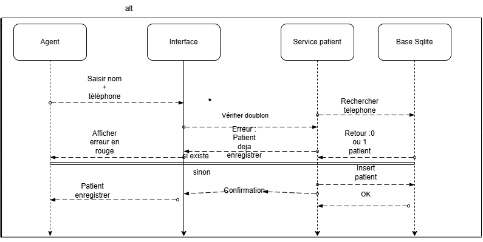

# Séance 5 - Architecture et Diagrammes Dynamiques
# Projet ISI - Gestion des Patients

## 1. Architecture choisie

Choix : Application Monolithique Modulaire + SQLite (sur site)

Justification : Moins chère, fonctionne sans Internet en permanence,
plus simple à maintenir pour un petit centre de santé.

Mode dégradé : Si Internet coupe, l'agent continue de saisir en local.
La synchronisation se fait quand la connexion revient.

Schéma : Interface (Agent / Médecin) -> Services (Patients, RDV, Paiement) -> Base SQLite -> Sauvegarde locale quotidienne

## 2. Tableau de comparaison

| Critère /5 | Monolithique + SQLite | Microservices + Cloud |
| --- | --- | --- |
| Coût | 5 | 2 |
| Performance | 4 | 4 |
| Sécurité | 4 | 3 |
| Évolutivité | 3 | 5 |
| Compétences équipe | 5 | 2 |
| Total | 21 | 16 |

Décision : On garde Monolithique + SQLite. Score 21 contre 16.

## 3. Diagrammes de séquence

Voir images ci-dessous.

### Cas 1 - Enregistrer un patient

### Cas 2 - Prendre un rendez-vous

### Cas 3 - Enregistrer un paiement

## 4. Diagramme d'états - Rendez-vous

RDV : En attente -> Confirmé -> Terminé / Annulé